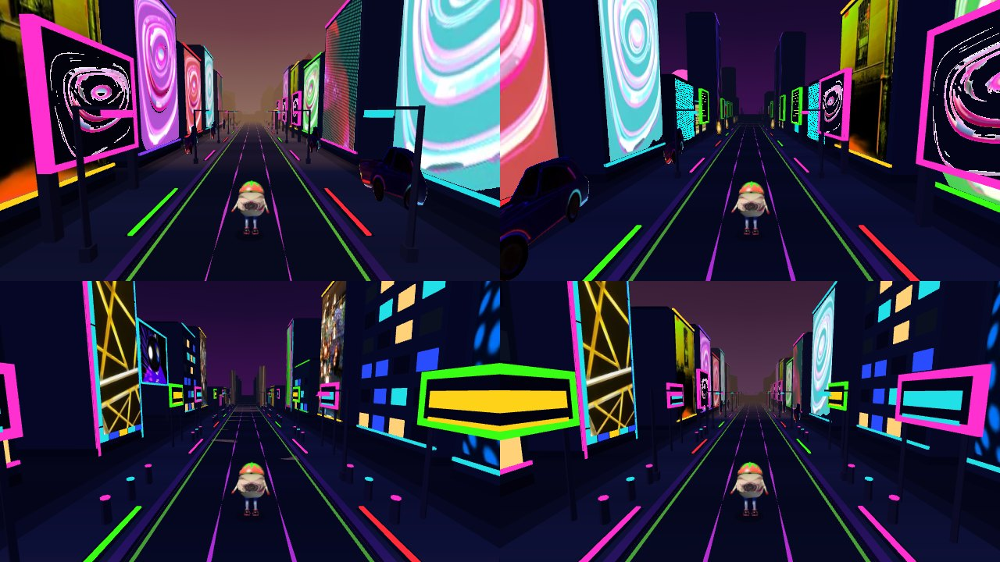
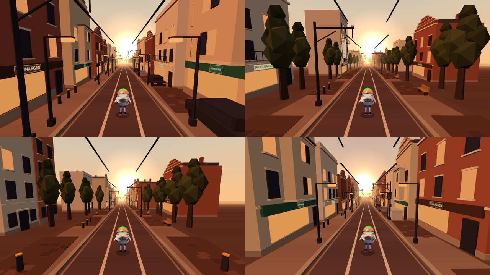
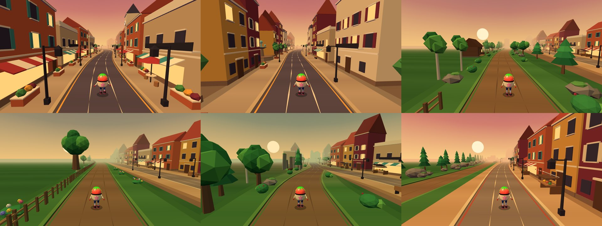
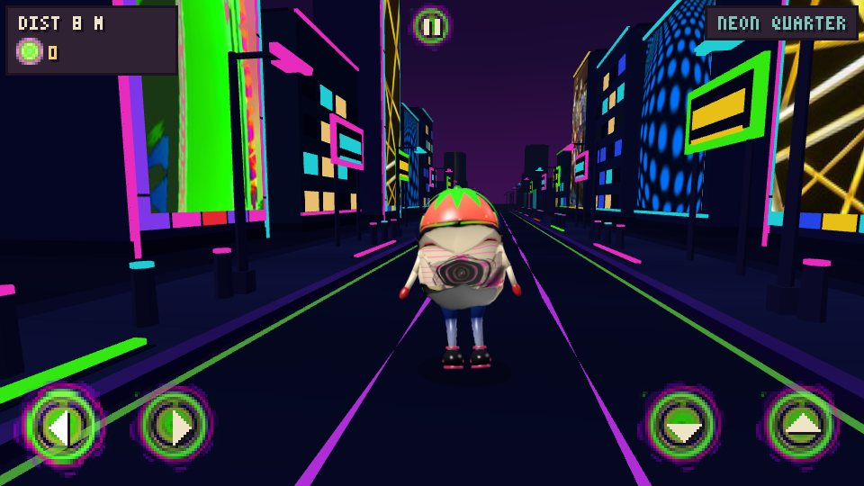

# WAYFARER — Prototype 01

A small branching endless runner, rendered in low-poly 3D with Three.js (the default page). The original pixel-art version (Canvas 2D, 320×180, scaled by whole numbers) is kept at `2d.html`. HTML + CSS + vanilla JavaScript; Three.js is vendored in `vendor/three.min.js` (MIT), so there is nothing to install and no build step.

## Run

```
cd wayfarer
python3 -m http.server 8080      # Windows: py -m http.server 8080
```

Open http://localhost:8080 for the 3D game (the default page). The original pixel-art 2D version is at http://localhost:8080/2d.html. Opening `index.html` directly in a browser also works.

## Play on a phone

Open the hosted page on an Android phone (Chrome). On-screen buttons appear automatically: hold ◄ / ► to steer, tap ▲ to jump, ▼ to slide, and the pause icon at the top. Landscape works best; the first tap on START asks for fullscreen and landscape. To try it from your own machine, run the server above and open `http://<your-computer-ip>:8080` on a phone on the same Wi-Fi.

## 3D build

Same game, same rules, rendered with Three.js as a low-poly 3D scene. Open **http://localhost:8080** (same server command as above); it is the default page. `/3d.html` redirects there, and `2d.html` is the classic pixel-art 2D version.

**Route:** Neon Quarter (opening) > city running section > visible fork > **LEFT: Greenwood (forest)** / **RIGHT: Market Detour (city)** > both merge into the same city plaza > the Neon Quarter > a second lap with variant segments (a different bend, length and obstacle mix) > **Saint-Gilles** (the sunset tram street) > a second junction with the same choice, then it loops. Both branches are fully their own biome within 15 m of the junction.

**The run opens in the Neon Quarter** (`neonStart`, 400 m, already night at distance 0, with the menu showing it behind the avatar); it fades back to the sunset city over its last 120 m and the first fork follows. `TRACK.base = 'city'` is the look every other segment blends from, so the opening piece being neon does not change them.

**Neon Quarter:** a night district of the city (`src3d/env_neon.js`, from your neon-city picture) between the first plaza and the second lap, as the track segment `neonRun` (`district: true`). The district is 500 m long (about 15 s at running speed). The sky, fog, light, road palette and scenery fade from the sunset city into the night over its first 120 m and back over its last 120 m (`World.bandsAt`), so it is entered and left smoothly; its neighbours are plain city pieces. Near-black asphalt with glowing magenta / green / red lines, tall slabs striped in yellow, purple, teal and magenta, blocks with lit windows, glowing signs, tube lamps, bollards, neon strips along the kerbs, a glowing gate pylon where it starts, and three landmarks (neon ring, spire, billboard). The 2D game gets a dark palette for the same biome so the shared track works.

Three of your pictures are on the district's walls (`src3d/neon_assets.js` / `neon_art.js`, one shared unlit atlas): the neon LOUNGE sign is the big billboard landmark (shown square, 7.4 m), a crop of the picture of coloured slabs is the facade of neon tower A, and the picture of glowing yellow lines is the facade of neon tower B.

The district was extended with eight more of your pictures (`src3d/neon_assets2.js`, one alpha atlas, alpha-tested): the blue discs are the facade of a block (`neonBlockD`), the hanging glass lamps the facade of a tall lounge (`neonBlockE`), the yellow-green stripes the front of a boutique (`neonShopC`), the orange tube on a wall a tall light blade (`neonBlade`), the green stripes a hanging banner (`neonBanner`), the bucket drawing and the glowing bottle street furniture (`neonBucket`, `neonBottle`), and the glossy ring a fourth landmark, a giant halo on two posts (`neonHalo`). Two new street characters use them: **boutiques** and **lounge**, so the district now has six.

A third set of 17 pictures (`src3d/neon_assets3.js`, one alpha atlas) adds 17 more props: the pink swirl on red / purple / green / teal grounds, a lit window on a wall and red dots as picture facades; a tall light-ray tower; cyan dots floating in front of a dark block; a striped boutique; the swirl (its white fill keyed out), a glowing cap shape and green lines as signs and banners on posts; a parked neon car; and four new pictures-on-posts landmarks (a purple vortex, a glass sphere, pink rings, a dark spiral), so the district has eight landmarks and eight street characters (new: **gallery** and **screens**).



**Saint-Gilles (the tram street):** a street in Saint-Gilles, Brussels, at sunset, from your two street photos (`src3d/env_tram.js`, `src3d/tram_art.js`), as the track segment `tramRun` (450 m, a `district` like the Neon Quarter, between the second lap's city run and the second fork). The sky, fog, light, road palette and scenery fade from the old town into it over the first 120 m and back over the last 120 m. A big low sun sits ahead, a little right of the road, with a soft orange glow (`sunPos` / `sunGlow` in the biome data, drawn by `Renderer3D`; the other zones keep the default sun), a pale blue-grey sky, warm haze, and one low orange light from ahead that rims the facades and leaves the rest in warm shade. The road is dark red-brown cobbles with the two lane lines drawn as continuous silver **tram rails** (`rails: true` in the road palette); overhead **tram wires** run unbroken over both rails with poles every third slot, swan-neck lamps, a cobbled parking strip with parked cars (rear lights on), dark tall trees, and townhouses in brick, cream and white with bay windows, iron balconies and Brussels stepped gables (eight types; neighbours on a side are never the same type: even and odd slots draw from separate sets). The trees are **your blossom-tree photo** (`src3d/blossom_assets.js` / `blossom_sprite.js`): cut out along the outline you drew (the crown closed up into a dense mass, the trunk kept), embedded as one WebP with alpha, drawn like the feather trees as two crossed planes 7.5 m tall and toned warm (`BlossomSprite.TINT`). From your three later photos the street was enriched: four more houses (an ochre-brick Art Nouveau house with red brick bands, a stone door surround, a wooden door and a big iron balcony; a white house with a dark-blue oriel; a red-brick corner house with a glowing green pharmacy cross and a wall lantern; a modern white block over dark brick), the dark-green lantern street lamps, rows of black bollards, street signs (parking, no entry), hedges, white market canopies over crates, stone steps, a parked lime e-scooter, manhole covers, a painted pedestrian crossing, and two more landmarks: the **school** (red brick with stone bands and a painted mural in each arched window) and a tall **glass tower** in the distance, gold where it catches the sun. The stretches now have seven characters (the two new ones: an Art Nouveau terrace, and a market corner). Shop fronts carry lettered fascias, and three landmarks appear at most once per stretch: the **Polyclinique** block (its vertical POLYCLINIQUE blade sign and the VERHAEGEN fascia from your photos), a **tram stop** with a TRAM plate, and a corner cafe. The signs are drawn at start-up on one small canvas atlas (`TramArt`, 14 cells, no image file). The street runs **downhill** (the last two photos were taken on a descent): the segment has `grade: 0.07` (7 %), and the road, the scenery, the coins and the hazards sit lower the further ahead they are, so the sun hangs above the road's far end. It is drawing only: gameplay stays flat (the runner is always at height 0), and `World.dropAt` / `gradeAt` give the fall, in proportion to the district blend so the slope eases in and out with the atmosphere; the far ground tips down with it so the road never sinks under it. Both photos are used for the look (palette, composition, signs), not pasted in: the street is built from low-poly parts like the other zones.



**Menu:** both panels are your own artwork (`src3d/ui_assets.js`, drawn by `Renderer.drawTitle3D` / `artPanel`). The title panel (top) keeps its text over the dark part, with the glowing red line between 'PROTOTYPE 01' and 'TAKE A FORK.'; the controls panel (below, whose text changes on a phone) is drawn under a dark veil so the text stays readable. The main button (it says PLAY in the 3D menu; the 2D page keeps START) is your ring artwork too (a band through the middle of your image; it glows green on hover and darkens when pressed, on a dark base with a dark plate behind the green label, so there is no white). If an image is missing, the usual drawn panel or amber button is used. RESUME and RUN AGAIN stay plain amber.

**World variety (all deterministic, no random state):**
- *Obstacle patterns* (`World.genSegment`): each spot takes a seeded pick from its segment's pattern list, never the same pattern twice running, and the gap to the next spot is the base spacing plus 0-49 seeded units (never less, so hazards stay >= 19 m apart). The run still opens with the gentle first pattern.
- *Segments:* `cityRunB`, `plazaB`, `forestB`, `detourB` and a second junction `gate2` (same biomes and names, different curves and lengths) join the loop.
- *Scenery stretches* (`src3d/stretch.js`): slots are grouped into stretches of 4-13 slots (50-150 m), each with its own character, and at most one landmark. Neighbouring stretches always differ (the variant and landmark kind are drawn from list entries of alternating parity) and landmarks are >= 3 slots apart. City: terrace, tree avenue, open square, shops, tall houses with gaps, walled walk; landmarks fountain / clock tower / statue. Forest: dense wood, clearing, pine stand, grove, rocky, fenced pasture; landmarks cabin / giant oak / standing stones. Market: stalls, open market, arcade, cobbles; landmarks market hall / fountain / big tent. Extra street furniture: walls, cafe tables, bollards, barrels, stumps, flowers, boulders.
- *Grass:* the forest's grass (verge, borders, curbs) is a dusk violet instead of green, with a violet sky, a dusty-rose fog and a violet ground light, to match the pink trees and the sunset. The bushes stay green.
- *Trees:* every tree (city, forest, giant oak) is your feather-tree artwork (`src3d/tree_sprite.js`, image in `src3d/tree_assets.js`): two crossed double-sided planes with one shared texture and material, a different height per kind (4.6 m to 12 m). Each tree stands in the middle of a round bed of flowers lying on the ground (a disc cut from the flower circle of your other image, tinted warm yellow / orange and brightened, radius 0.23 x height + 0.4 m, 1.5 m for the city tree up to 3.2 m for the giant oak) with a ring of upright flowers (pink, yellow, orange; two crossed planes each, 0.4-0.75 m tall, 10 to 23 per bed, placed by a fixed formula) round its rim. Tree, bed and flowers share one atlas texture, so there is still one draw per tree. They are unlit, so the artwork keeps its colours, but fogged like the rest.
- *Transitions:* the biome of each side switches once, cleanly, as the blend passes about half, and a small entrance marker (stone gate post / carved wood post / pennant pole) stands where the street changes character.
- Pools are fixed-size and shared (peak use <= 71 %); layouts are cached per slot and trimmed.



**How a junction works**
- The track is data (`src/track.js`): a `sequence` of segments (each with a biome, length, curve, obstacle patterns) and a `fork` (diverge zone, branch length, merge zone, biome blend, which segment each side leads to). `src/world.js` turns it into pieces and answers "where are the road(s) at distance z?" for gameplay and rendering alike.
- Road geometry (`src3d/road3d.js`): the road, curbs, sidewalks and verges are two *ribbon* meshes rewritten each frame from that data, so a fork is real geometry: one road splits into two that diverge, run apart, and merge back, with the same width, surface height and curve as gameplay. Where roads touch, each takes its half up to the midline (no overlap, no z-fighting); the inner curbs shrink to nothing at the tip. A prebuilt straight segment mesh cannot do this, which is why the road is streamed (64 sections x 3 m, always reused); scenery and items use bounded pools.
- Choosing: a LEFT / RIGHT prompt appears 76 m before the junction, with two route signposts and the visible fork. Steering is free until then and never picks a road by itself. A left/right input given inside the prompt window is the pick (highlighted in the prompt); with no input the side you are standing on is used. The pick is locked when you cross the junction line (once per junction); in the last 35 m before it the runner is eased onto the picked road, and afterwards the opposite key cannot re-route.
- Camera: a chase camera behind and above the runner that follows the active route's centre, looks 20 m down it, and blends gradually into the fork's biome. Sky, fog and light colours, road palette and scenery all blend between city, forest and market (scenery per road side is chosen per 12 m slot by the blend at that spot).
- Biomes are `src3d/env_city.js`, `env_forest.js`, `env_market.js` (colours, road palette, props, layout rule); the market detour reuses the city's buildings and street props with a different layout and a warmer cobbled road. A new biome is a new `ENV3D.<id>` plus a segment in `track.js`.

**Avatar:** your own retouched artwork (`src3d/runner_sprite.js`, images embedded in `src3d/avatar_assets.js`), shown as flat cards that always face the camera: the **back view** while playing (the chase camera sees the runner from behind) and, by default, the same back view in the main menu (`?menu=side` shows the side view instead), turned to face the menu camera as it orbits, with an idle / wave / spin / dance / run-in-place showcase. With no skeleton, the motion is applied to the whole card: run bounce and squash-and-stretch, a steering lean, a stretch in the jump, ducking (squashed to 42 % of its height, under 0.9 m) for the slide, tipping forward on a crash. It stands 1.9 m tall with its feet on the road. `?avatar=3d` in the URL selects the earlier 3D strawberry-man model (`src3d/runner3d.js`) instead; the transparent PNG exports in `docs/downloads` come from that model.

**Gameplay loop (shared rules in `src/game.js`, drawn in 3D)**
- *Controls:* steer left/right (arrows or A/D, continuous across the three marked lanes), Space/Up jump (0.55 s, ~3 m apex, 0.12 s landing buffer), Down slide (0.55 s; tapping again mid-slide does not chain it; Down in the air fast-falls; a jump cancels a slide). Forward movement is automatic. Auto-repeat key events are ignored; jump/slide always return to running.
- *Coins:* pooled ringed coins (green core, cream and lime bands, a pink ring and a lilac edge) that spin and bob, in lines, groups, zig-zags and left/right lane trails, plus a coin trail on each branch of a fork. Pickup box: ~0.7 m sideways, ~0.9 m in depth, and the runner's body height must overlap the coin height (high coins need a jump). The counter updates the frame you pass through; each coin counts once; a collected coin disappears in that same frame (it is flagged `taken` and skipped by the draw loop) and a separate burst of tiny green / pink / lilac sparks plays for 0.3 s. The sparks deliberately do not use the coin mesh: a coin-shaped effect at the same spot looks exactly like the coin staying on the track.
- *Hazards (what you see is what you hit — meshes are built from the collision table `OBST`):* crate (1.2 m, jump), low striped barrier (2.8 m wide, jump), overhead gate (banner 1.05 m above the road, slide; you can only get round it at the very edge of the road). Spacing is >= 19.5 m, the first hazard is ~69 m in, and the last 66 m before every junction is hazard-free (that stretch is where the picked road gently guides the runner).
- *Game over:* any collision ends the run: debris burst, screen shake, red flash, the avatar tips over. Distance, speed, coins, spawning and track updates all stop and the chosen route is kept; the panel shows distance, coins, score and best. Restart (button, Space, Enter, R) gives a clean run.
- *Difficulty:* speed starts at 22 m/s and rises 0.16 m/s per second to a 34 m/s cap; distance is the integral of speed and is unaffected by forks or recycling.

**Works in 3D:** all of the above, plus pause, touch controls, resizing, both branches with hazards and coins active.

**Tested** (headless Chromium, software WebGL, simulation stepped frame by frame; suites live outside the repo): 3D gameplay 35 checks, 3D routes/geometry 34, 3D phone touch 9, 2D regression 50; plus extra probes: frame-rate independence (clearing windows match from 20 to 144 fps, no tunnelling at 34 m/s), input state-machine fuzz (6 simulated minutes, 17 restarts), a brute-force survivability search over every distinct hazard pair of the looping track on both branches at 22 and 34 m/s (all 37 pairs clearable), and a 12-minute bot run through 62 junctions with constant memory.

**Limitations**
- Real-device frame rate and touch feel are not measured. Per-frame JavaScript allocation in the 3D draw path is about 12 KB (down from 57 KB), mostly small temporaries.
- Steering is continuous across the road (as in the 2D game), not snapping between three lanes. Collision uses the hit boxes above; the avatar's hair and outstretched arms are drawn slightly taller/wider than its 1.8 m hit box, so a close shave is forgiving, never a phantom hit.
- The road you did not take stays visible with its coins and hazards (it cannot be touched: you are confined to your road and the two are metres apart). Pickup sparkles and dust are 2D-only; the 3D build has its own coin pop and crash debris.

## Controls (keyboard)

| Key | Action |
|---|---|
| Q / D, A / D or ← / → | steer (Q, Z, S, D work by letter on any layout; on an AZERTY keyboard the ZQSD keys work by position too) |
| Space, Z, W or ↑ | jump (crates, low barriers) |
| S or ↓ | slide (overhead banners and vines) |
| P or Esc | pause / resume |
| Enter, Space or R | start / restart (the on-screen buttons work too) |

**Touch buttons** (phones): each one wears your neon ring picture (`src/touch_assets.js`, scaled to the overlay's pixel grid, with its arrow or pause symbol drawn over it; a held button grows and lights up). The hit boxes did not change.



At a fork, lean to the road you want (or tap ← / →) before crossing the junction line. The prompt shows the current pick.

## Layout

```
index.html (3D game), 2d.html (classic 2D), 3d.html (redirect to index.html), style.css
src/audio.js    sound: the music track + beat clock, synthesised effects, mute
assets/         music.mp3 (the track)
src3d/*         3D front end: kit, road3d, stretch (scenery stretches), env_city/forest/market/neon/tram (+ neon_art / neon_assets, tram_art, blossom_sprite + blossom_assets), runner_sprite + avatar_assets (the artwork avatar), tree_sprite + tree_assets (the artwork trees), ui_assets (the menu-panel artwork), runner3d (the 3D model), items3d, fx3d, signs3d, renderer3d, main3d
vendor/         three.min.js (Three.js r186)
tools/preview3d.html  dev page that renders one 3D module in isolation
tests/qa3d_coins.js   regression test: coin pickup (coins vanish at once, count once, can't be re-collected, pool reuse, both branches, restart)
tests/qa3d_world.js   regression test: world variety, track integrity, pools, six junctions played
tests/qa3d_audio.js   regression test: sound and music (locked until a gesture, the track and its beat grid checked against the decoded mp3, every event's effect, offline-rendered effects, mute, animation on the beat)
tests/qa3d_controls.js regression test: keyboard bindings (arrows, WASD, ZQSD / AZERTY), the neon-ring touch buttons and the menu key text
tests/qa3d_ui.js      regression test: both menu-panel artworks load, are drawn, controls text legible (with a fallback to the drawn panels)
tests/qa3d_avatar.js  regression test: the artwork avatar (default), ?avatar=3d, images load (also from file://), view per state, size / ground / slide height, faces the camera, no leaks
src/biomes.js   palette + biome definitions (city, forest, market)
src/track.js    track pieces, obstacle patterns, collision boxes
src/world.js    road geometry, fork/merge logic, item spawning
src/sprites.js  programmatic pixel-art sprites and skylines
src/font.js     3×5 pixel font
src/render.js   drawing: sky, road, objects, HUD, screens
src/game.js     state, input, loop, collisions, scoring
```

## Sound and music

- **Music:** your "Deep Disco" track (`assets/music.mp3`, 172 s, looped; converted from the m4a and lowered 3 dB so it does not clip) plays from the first tap or key press (browsers do not allow sound before one; on phones a touch's first event is not accepted as a gesture, so every gesture retries until the music is really playing). Its volume follows the game: softer in the menu, full while running, ducked on pause and after a crash.
- **Animation to the beat:** the track is a steady 117.7 BPM and `src3d/music_beats.js` holds its beat grid and loudness curves, computed offline (`tools/make_beatmap.py`), so nothing is analysed in the browser (that would not work from `file://`). On every kick the avatar bounces and stretches, the scene light and all the glowing neon parts brighten, and the PLAY button glows green; the effect is stronger in the neon quarter and weaker in quiet parts of the track. Before the sound starts the same clock runs at the same tempo, so the menu already moves in time.
- **Effects** (synthesised with the Web Audio API, no sound files): jump, land, slide, coin (the pitch climbs with a streak of coins), crash, game-over jingle, fork prompt and fork choice, start, pause and resume.
- **Mute:** `M`, or the speaker icon at the bottom right of the menu / pause / game-over screens; remembered between visits.
- The classic 2D page (`2d.html`) is silent.
- To change the music: put another track in `assets/music.mp3` and run the two ffmpeg / python commands at the top of `tools/make_beatmap.py`.

## Dabke video

`docs/downloads/dabke-neon-quarter.mp4` (33 s, 960x540, 30 fps, with sound): five copies of the character (the 3D model, which has legs and arms) dance dabke in the Neon Quarter. Dabke is the stomping line dance of Syria and the Levant, so they hold hands in a line, step sideways together, stamp on the beat (a neon ring spreads from every stamp), and the leader on the right swings a red-and-white handkerchief and twirls once. Five camera shots cut on the beat. The sound is your track from 2:16 plus a synthesised dabke percussion layer (the maqsum rhythm, foot stamps on the steps, claps) on the track's beat grid. It is rendered from the game's own scene, frame by frame and deterministically; `tools/dabke_video/` has the scripts (`render.js`, `make_drums.py`, `build.sh`) and reproduces the file byte for byte.

## Tests

```
npm i playwright-core            # once, anywhere (or point PW_CORE at an existing install)
CHROMIUM=/path/to/chrome node tests/qa3d_coins.js
CHROMIUM=/path/to/chrome node tests/qa3d_world.js
CHROMIUM=/path/to/chrome node tests/qa3d_avatar.js
CHROMIUM=/path/to/chrome node tests/qa3d_ui.js
CHROMIUM=/path/to/chrome node tests/qa3d_audio.js
```

Set `TEST_URL=https://your-deployment/` to run the same checks against a deployed copy. Both start their own static server, drive the real page (scene graph and game rules, WebGL stubbed for speed) and exit non-zero on failure. `qa3d_coins.js` asserts on every frame that the number of coin meshes on screen equals the number of uncollected coins in range, so a collected coin that stays visible (or an effect built from the coin mesh) fails at once.

Score = distance in metres + 10 per coin. Best score is kept in `localStorage`.
