# WAYFARER — Prototype 01

A small branching endless runner, rendered in low-poly 3D with Three.js (the default page). The original pixel-art version (Canvas 2D, 320×180, scaled by whole numbers) is kept at `2d.html`. HTML + CSS + vanilla JavaScript; Three.js is vendored in `vendor/three.min.js` (MIT), so there is nothing to install and no build step.

## Run

```
cd wayfarer
python3 -m http.server 8080      # Windows: py -m http.server 8080
```

Open http://localhost:8080 for the 3D game (the default page). The original pixel-art 2D version is at http://localhost:8080/2d.html. Opening `index.html` directly in a browser also works.

## Play on a phone

Open the hosted page on an Android phone (Chrome). On-screen buttons appear automatically: hold ◄ / ► to steer, tap ▲ to jump, ▼ to slide, and the pause icon at the top. Landscape works best; the first tap on START asks for fullscreen and landscape. To try it from your own machine, run the server above and open `http://<your-computer-ip>:8080` on a phone on the same Wi-Fi.

## 3D build

Same game, same rules, rendered with Three.js as a low-poly 3D scene. Open **http://localhost:8080** (same server command as above); it is the default page. `/3d.html` redirects there, and `2d.html` is the classic pixel-art 2D version.

**Route:** Neon Quarter (opening) > city running section > visible fork > **LEFT: Greenwood (forest)** / **RIGHT: Market Detour (city)** > both merge into the same city plaza > the Neon Quarter > a second lap with variant segments (a different bend, length and obstacle mix) > **Saint-Gilles** (the sunset tram street) > a second junction with the same choice, then it loops. Both branches are fully their own biome within 15 m of the junction.

**THE CIRCUIT, ZONE BY ZONE (the current order).** The run goes Neon > Beach > Saint-Gilles > Utrecht > Neon again, and so on (`TRACK.sequence` in `src/track.js`): the neon quarter (the run opens in it, `neonStart`, then `neonRun` on later laps), **the beach** (all the coast is one zone now, 900 m in all, with the coast music throughout and no door inside it: the 420 m coastal piece with the chalets, the dunes and the giant sunburst parasols, then the 480 m coastal town with the long buildings, the two clubs, the roundabouts and the saucer, both in the same one of the four lights by turns; there are no coast branches at the junctions any more), **Saint-Gilles** (the street, the junction with its forest / market / ruins detours, the tram street, the Gare du Midi), then **Utrecht** by train. There is **one passage between a zone and the next**, a pair of Stargate doors (entry and exit, see below); Saint-Gilles to Utrecht is the train, not a door. The junction detours (forest, market, ruins) are part of Saint-Gilles and have no doors. The pairs that led to the coast or the neon quarter (`gate2`, `gate3`, `gate4`, `gate3B`, `gate4B`) and the segments `coastRun`, `coastRunB`, `neonBranch`, `neonBranchB` are still defined in `src/track.js` but no longer on the circuit; the junction pairs it uses are `gate` (forest / market), `gate5` (ruins / market) and `gate6` (forest / ruins). Older paragraphs below describe the circuit as it was when each part was added.

**Five destinations** (prompt 12). The forks used to lead only to Greenwood (forest) and the Market Detour. There are now six fork pairs and five destinations, each its own place:

| Destination | Mood | Road | Scenery and landmark | Its small gameplay identity |
|---|---|---|---|---|
| Greenwood (forest) | dark green, shafts of light | dirt | pines and oaks, cabin, giant oak, standing stones | (unchanged) |
| Market Detour | warm city | cobbles | stalls, houses, market hall | (unchanged) |
| **Sunset Coast** (`src3d/env_coast.js`) | low orange sun over the sea, peach and coral sky, warm haze | warm grey road, sand verge | the sea on the left (water, foam lines, glints, boats, buoys), dunes with beach grass, sandstone cliffs, white cottages with blue shutters, wooden fences, **a lighthouse** and **a pier** | **a safe sprint**: coin waves and a straight of coins, almost no hazard (0.3 per pattern against 1.1 in the forest, a low driftwood log now and then) |
| **Mossy Ruins** (`src3d/env_ruins.js`) | dark teal sky, a pale moon, thick green fog and green light | mossy stone cobbles | moss-capped walls with hanging vines, standing and broken columns, **stone arches that close over the road** (two halves that meet), glowing green lanterns, **a ruined temple** and **an obelisk** | **the fallen wall**: three barriers across all three lanes at once, it cannot be steered round, it has to be jumped (coins arc over it) |
| **Neon District** (the quarter's kit, plus `neonWire` / `neonPole` / `neonPuddle`) | night, violet sky, glowing signs | near-black asphalt, glowing lane lines | the Neon Quarter's towers, shops (with their windows) and signs, **overhead cables on poles** over the road and **wet, reflective-looking patches** of road | **the double gantry**: two overhead hazards 1.4 m apart (one slide gets under both) and **strobing crates** that leave the middle lane open |

The six fork pairs: forest / market (the first fork, as before), forest B / market B, **coast / ruins**, **neon district / forest**, **coast B / neon district B**, **ruins B / market B**. The two fork slots of every lap (A and B) pick one of three pairs each (`TRACK.picks`), never the same pair twice in a row in a slot, so the destinations come in a different order lap after lap, and **run after run**: a real player gets a random `World.seed` (`Game.runSeed`; `?seed=N` pins one, and automated browsers always get seed 0, the canonical order, so tests are reproducible). Seed 0 starts forest / market, then forest B / market B, then the picks vary. Every choice is two clearly different destinations with a signpost on each side (a sun over waves, a stone arch with a green keystone, a neon ring, the pines, the market house) 42 m and again 14 m before the junction, and the LEFT / RIGHT prompt 76 m before it. Every branch is a segment of its own with a variant B (a different bend, length and pattern mix) and its own coin trail through the junction; the unselected road stays inaccessible, exactly as before. 2D game: the three new roads have a palette and a sign sprite each (`BIOMES.coast / ruins`, `SPR.signCoast / signRuins / signNeon`); the classic 2D game plays them.

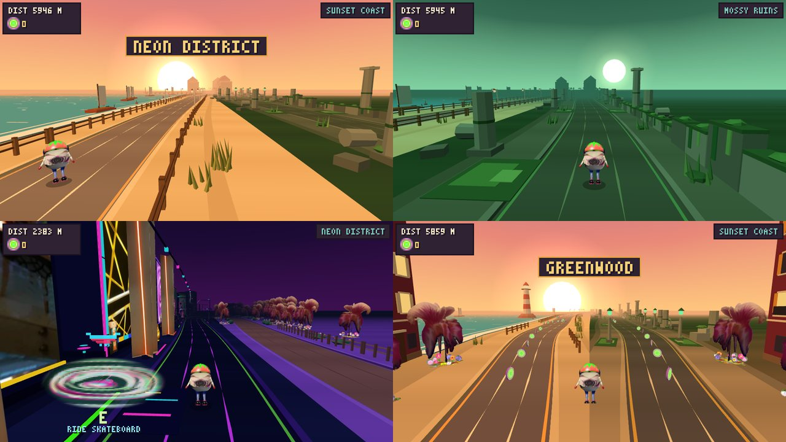

**The run opens in the Neon Quarter** (`neonStart`, 400 m, already night at distance 0, with the menu showing it behind the avatar); it fades back to the sunset city over its last 120 m and the first fork follows. `TRACK.base = 'city'` is the look every other segment blends from, so the opening piece being neon does not change them.

**Neon Quarter:** a night district of the city (`src3d/env_neon.js`, from your neon-city picture) between the first plaza and the second lap, as the track segment `neonRun` (`district: true`). The district is 500 m long (about 15 s at running speed). The sky, fog, light, road palette and scenery fade from the sunset city into the night over its first 120 m and back over its last 120 m (`World.bandsAt`), so it is entered and left smoothly; its neighbours are plain city pieces. Near-black asphalt with glowing magenta / green / red lines, tall slabs striped in yellow, purple, teal and magenta, blocks with lit windows, glowing signs, tube lamps, bollards, neon strips along the kerbs, a glowing gate pylon where it starts, and three landmarks (neon ring, spire, billboard). The 2D game gets a dark palette for the same biome so the shared track works.

Three of your pictures are on the district's walls (`src3d/neon_assets.js` / `neon_art.js`, one shared unlit atlas): the neon LOUNGE sign is the big billboard landmark (shown square, 7.4 m), a crop of the picture of coloured slabs is the facade of neon tower A, and the picture of glowing yellow lines is the facade of neon tower B.

The district was extended with eight more of your pictures (`src3d/neon_assets2.js`, one alpha atlas, alpha-tested): the blue discs are the facade of a block (`neonBlockD`), the hanging glass lamps the facade of a tall lounge (`neonBlockE`), the yellow-green stripes the front of a boutique (`neonShopC`), the orange tube on a wall a tall light blade (`neonBlade`), the green stripes a hanging banner (`neonBanner`), the bucket drawing and the glowing bottle street furniture (`neonBucket`, `neonBottle`), and the glossy ring a fourth landmark, a giant halo on two posts (`neonHalo`). Two new street characters use them: **boutiques** and **lounge**, so the district now has six.

A third set of 17 pictures (`src3d/neon_assets3.js`, one alpha atlas) adds 17 more props: the pink swirl on red / purple / green / teal grounds, a lit window on a wall and red dots as picture facades; a tall light-ray tower; cyan dots floating in front of a dark block; a striped boutique; the swirl (its white fill keyed out), a glowing cap shape and green lines as signs and banners on posts; a parked neon car; and four new pictures-on-posts landmarks (a purple vortex, a glass sphere, pink rings, a dark spiral), so the district has eight landmarks and eight street characters (new: **gallery** and **screens**).


**Saint-Gilles (the tram street):** a street in Saint-Gilles, Brussels, at sunset, from your two street photos (`src3d/env_tram.js`, `src3d/tram_art.js`), as the track segment `tramRun` (450 m, a `district` like the Neon Quarter, between the second lap's city run and the second fork). The sky, fog, light, road palette and scenery fade from the old town into it over the first 120 m and stay at full strength to the station (`stay: true`). A big low sun sits ahead, a little right of the road, with a soft orange glow (`sunPos` / `sunGlow` in the biome data, drawn by `Renderer3D`; the other zones keep the default sun), a pale blue-grey sky, warm haze, and one low orange light from ahead that rims the facades and leaves the rest in warm shade. The road is dark red-brown cobbles with the two lane lines drawn as continuous silver **tram rails** (`rails: true` in the road palette); overhead **tram wires** run unbroken over both rails with poles every third slot, swan-neck lamps, a cobbled parking strip with parked cars (rear lights on), dark tall trees, and townhouses in brick, cream and white with bay windows, iron balconies and Brussels stepped gables (eight types; neighbours on a side are never the same type: even and odd slots draw from separate sets). In Saint-Gilles the runner can **ride a lime kick scooter, when they want**. Parked scooters and scooter stations (a platform with a charging post and four scooters) stand on the pavement; a translucent **disc** marks the ground right under the nearest one ahead: your green swirl picture (`src/ring_assets.js`, cut out of its flat backdrop and reshaped into a round disc with a soft edge), squashed into the ground's perspective, turning slowly and breathing a little (the picture's own colours: no glitch, no rainbow). It is big enough to see from far away (about 38 px across at 125 m, about 60 px at 25 m, in the 320 px wide HUD) and it **says what it is for**: a floating pixel drawing of the vehicle above it (a lime scooter, or a cyan skateboard with a red glow), and below it the key, **E** (or **TAP** on a touch device), and **RIDE SCOOTER** / **RIDE SKATEBOARD**. Not a sign, nothing solid. Tap or click the disc (or the drawing above it, or its words), or press **E**, and the runner gets on (that scooter is taken); **E** again, or the **HOP OFF** button on a touch device, gets off. It also ends when the street ends and on a restart. Riding is drawing only (`RunnerSprite.buildScooter`, a small low-poly model like the one in your photo): the card stands on the deck, the run bounce gives way to a steady glide, the wheels spin, the scooter leans with the steering and lifts its nose in the jump; the hit boxes and the speed are unchanged. Only the artwork avatar rides (the `?avatar=3d` model does not). `?scooter=1` forces riding everywhere, `?scooter=0` never (for testing). A transparent PNG of the scooter to refine elsewhere is in `docs/downloads/scooter.png` (3/4 view, 1536 x 1024) and `scooter-views.png` (side, front, rear, top); `node tools/render_scooter.js` makes them.

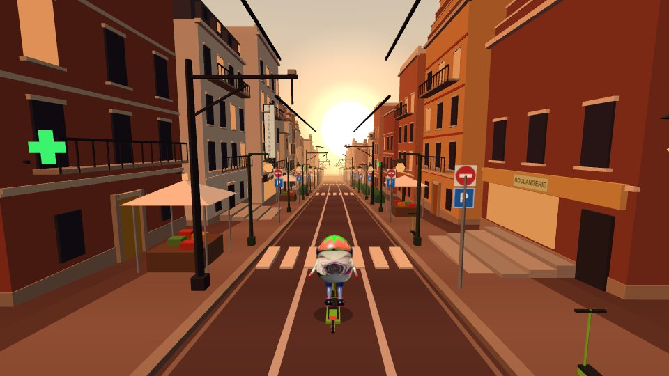

**The independent coastal zone (on the main circuit, four lights).** The coast is no longer only a branch of two junctions: right after the neon quarter, on every lap, the main road runs along a 420 m coast road of its own (`coastMorning` / `coastMidday` / `coastSunset` / `coastBlueHour` in `src/track.js`, the same safe sprint of coin waves, dunes and a few barriers; `pick: 'C'` in the sequence, `TRACK.pickSegs`). **One light per passage**, by turns: each time the run reaches the coast it is the next of sunset > midday > blue hour > morning haze (the canonical seed starts with the sunset; a real run starts at a seeded one, so every run meets all four, one after the other). Each light is an environment over the same props (`ENV3D.coast`, `coastNoon`, `coastBlue`, `coastMorning` in `src3d/env_coast.js`: only the sky, fog, light and road palette differ; the sea strip's colours are drawn into its geometry and stay), the HUD names it (SUNSET / MIDDAY / BLUE HOUR / MORNING COAST) and the coast music (afro Mediterraneo) plays under all four (`/^coast/` in `src/audio.js`). The coast branches of the two junctions are unchanged (the sunset look). Your coast photos can later be used as they are, like the Utrecht ones. `tests/qa3d_coastzone.js` checks the track, the rotation (also by seed), the four atmospheres and the music, a bot through each piece, and the 2D game.

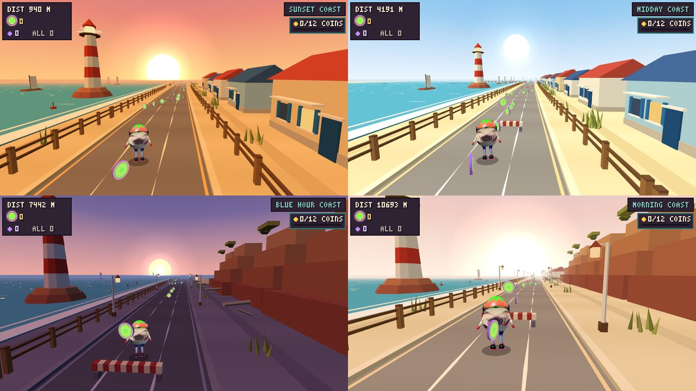

**The Strawberry Beach Club** (a long building, so a prop of the coastal town and never among the chalets, about twice per town, on the land side: `club` in `src3d/env_coast.js`, `src3d/coast_art.js`, `src3d/coast_assets.js` made by `tools/make_coast_assets.py`). A terrace on a wooden deck: white railings with surfboards leaning on them, tables under pink and white parasols, a low bar with stools, a string of lights, a pink canopy with a scalloped fringe. **Its backdrop is your 'STRAWBERRY WEEKEND' picture, stretched wide** (a 11.5 x 4.55 m panel for a square picture, 2.5 times wider than it was; only scaled, never recoloured), under a drawn neon name board 'STRAWBERRY BEACH CLUB'; your 'EL MEDITERRANEOS' anchor sign stands apart on two posts planted in the ground, 3.45 m beyond the far end of the terrace and nearer the road, facing the runner, so that it never covers the strawberry picture (`SIGN_Z` in `src3d/env_coast.js`). It appears under all four lights and on the coast branches of the junctions (same prop set).

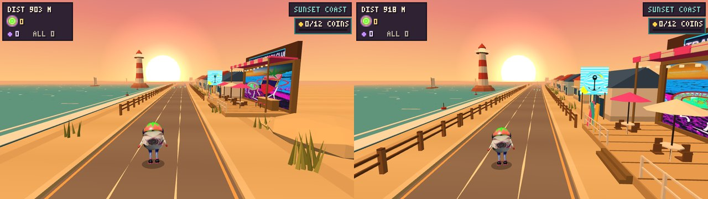

**Club Delphi** (the second club, also in the coastal town, never among the chalets: land side, once or twice per town and never beside the Strawberry Beach Club: `delphi` and `dolphin` in `src3d/env_coast.js`, the sign in `src3d/coast_art.js`). A whitewashed cabin in the manner of the Greek islands (white cube, blue door and shutters, a small blue dome, a striped awning, bougainvillea), a tiled terrace with blue and white parasols, a **dolphin sculpture** leaping out of foam on a pedestal beside the road (a chain of eleven low-poly ellipsoids along an arc, pale belly, beak, dorsal and pectoral fins, flukes, eye; about 4 m high with its pedestal) and, across the entrance on two posts, the **dolphin sign** 'CLUB DELPHI' facing the runner (a 2.8 m square plate: navy rim, a round window of sea and sky with a low sun, a leaping dolphin over white-capped waves, the name below). Both dolphins are original drawings made in code: no uploaded picture is used or touched for this club (the Strawberry Beach Club pictures keep being shown exactly as sent). It appears under all four lights and on the coast branches of the junctions.

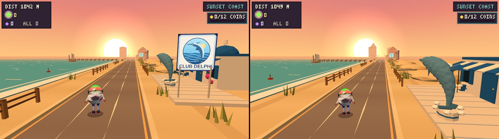

**The coastal town (the second half of the beach zone, from your painting and your sunburst).** From your painting of a seaside town: **tall painted towers** along the land side (yellow with a red outline, red with a navy one and two magenta neon strips, a tall blue one with warm windows and a cyan strip, a peach one with navy windows: bold outlines, arched cream window columns, `src3d/env_town.js`), **flower roundabouts** with your flowers (the ring of patches of your tree beds, widened) under a giant parasol, a turquoise **landing pad** where a dark **flying saucer** hovers (a dark lens with a dome and a neon underside, `src3d/saucer3d.js`) and takes off, tilting, up and out over the sea, when the runner is within 75 m (it stays gone). The sea side is the coast's own. **The long buildings are separate from the chalets**: the cottages of the beach (the chalets) stand only in the coastal piece, the towers and the two clubs only in the town, and the town is the piece after it, in the same light (`townSunset` / `townMidday` / `townBlueHour` / `townMorning`, `pickSegs.D`). The coastal piece stays in to its end and the town is in from its first unit, so nothing dips back to the city look and there is no door between them. **Your red and cream sunburst** is the canopy of the **giant beach parasols** (`src3d/parasol_assets.js` made by `tools/make_parasol_assets.py`: cropped to the square round the centre of the rays and scaled, nothing else; wound on a cone seen from above so the rays run down it like the ribs of a parasol, `src3d/parasol_art.js`): one every 13th slot on the beach and over each roundabout. `tests/qa3d_town.js` checks the order and the lights, the hand-over, the separation, the picture, the towers, the roundabouts, the pad, the saucer, the pools and the 2D game.

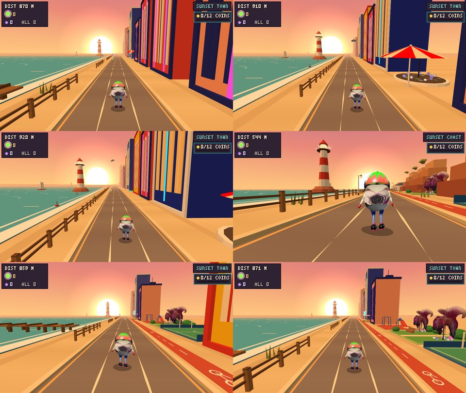

**Everyday life on the coast (a standing rule: green spaces in every plan, and on the coast also a bike lane and youth and sports grounds).** On the beach and in the town: a **bike lane** along the land side of the road on every slot (a 1.2 m terracotta strip with white dashes and a bicycle sign, `coastBike`), **green spaces** (`coastPark`: a lawn with a gravel path, clumps of bushes and a bench, with two of your feather trees each, the same `tree` prop as Saint-Gilles), a **sports court** (`coastCourt`: a green pitch with white lines and a centre circle, two football goals, a basketball hoop, a low blue wall) and a **youth playground** (`coastPlay`: a rubber surface, a swing set, a slide with its platform, a sandpit). On the beach they replace a chalet now and then (every 11th, 19th and 15th slot), in the town a tower (every 7th, 11th and 13th). `tests/qa3d_town.js` checks them.

**The Stargate passages (3D build).** Every change of zone (Neon > Beach > Saint-Gilles > Utrecht > Neon, one passage between each; not the train) is a journey through a stargate, with your picture of pink neon rings as the door (`src3d/portal_assets.js` made by `tools/make_portal_assets.py`: only scaled down from 4200 x 3420, drawn additive so that its black is transparent; `src3d/portal_art.js`, `src3d/portal3d.js`). A zone is a family of biomes: Saint-Gilles (city + tram + gare), the coast in its four lights, Utrecht, the neon quarter, the forest, the market, the ruins. Each passage has an **entry door** (the transmitter) at the end of the old zone and an **exit door** (the receiver) 70 m after it, so far that it cannot be seen from the entry door (an exit door only fades in within 70 m, an entry door from 120 m); the junction detours of Saint-Gilles (forest, market, ruins) are part of the zone and have no doors. The middle of the picture is a **black hole** (a black disc over it, where you circled the small dark patch, moved 2 m down to the centre of the rings, `HOLE` in `src3d/portal_art.js`): as the runner reaches the entry door it is pulled into it (the last 14 m: it rises, spirals in, turns and shrinks away), it is out of sight between the doors, and it falls out of the middle of the exit door (out before it goes through it) and settles back onto its road. Between the doors the screen is lit pink (a vignette, light streaks, a flash at each door, a third of the flash with reduced motion) and two voices play (`portalIn`, `portalOut`). **The road of a journey, from the start of the pull to 2 m after the exit door, has no hazards** (the runner is out of sight there, so nothing it could not see is in its way; it is not made invincible, the hazards are taken out when the passage is first seen). The passage out of the Gare du Midi, where the train takes the runner to Utrecht, is left as it was; the classic 2D game has no doors. `tests/qa3d_portal.js` checks which passages have doors, the picture, the placement and the fade of the doors, the black hole, the journey of the runner, the hazard-free road, the light and the voices, the overlay pixels, reduced motion and the 2D game.

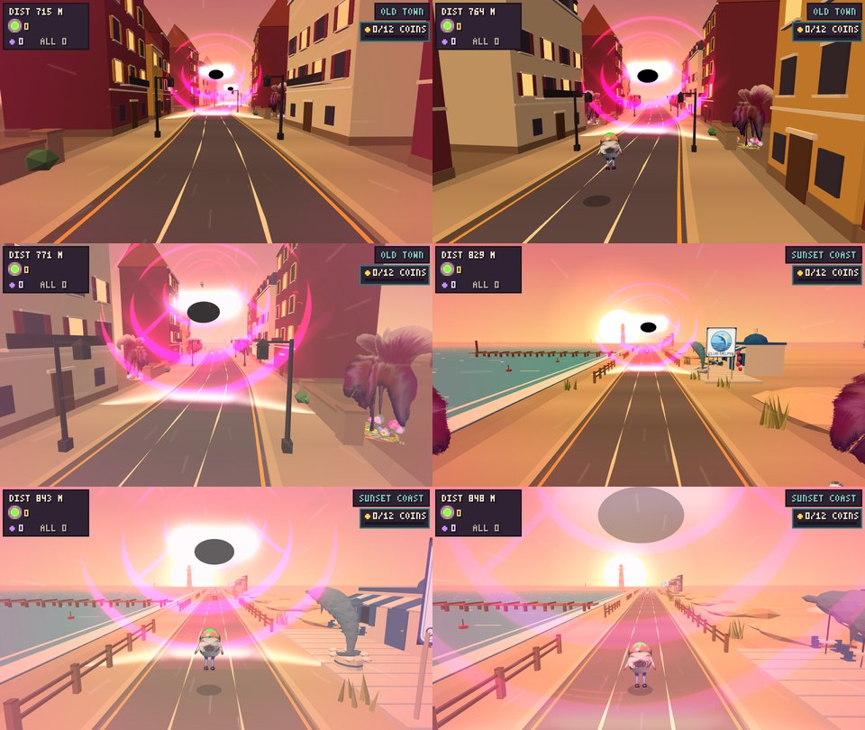

**The scooter indicator** keeps its disc on the ground under the vehicle and the vehicle floating above it, but the key and what it does (`E RIDE SCOOTER`, `TAP` on a phone) are now plain text (with a dark shadow, no plate) at the left edge, under the counters, instead of text on the road beside the runner.

**Coastal zone prototypes.** `tools/coast_protos.js` renders the Sunset Coast as it is in the game and three other atmospheres tried on the real branch road (midday Mediterranean, blue hour, morning haze), by overriding the zone's sky / fog / light / road palette at run time (nothing in the game changes; the sea strip's colours are baked into its geometry and stay). Stills: `docs/screenshots/coast-<coucher|midi|bleue|brume>-<a|c>.jpg`.

**Utrecht, the canal (in the game).** The zone the train of the Gare du Midi goes to: the run is on the water of Utrecht's canals, on a short surfboard, at blue hour. Three stretches on the track (`utrechtA`, `utrechtB`, `utrechtC` in `src/track.js`, one atmosphere): the basin in front of Utrecht Centraal (open and calm, 220 m), the covered gallery under Hoog Catharijne (180 m, gates to slide under) and the Oudegracht (520 m: two levels of quays with lit wharf cellars, gabled houses, humpback stone bridges every 96 m, the Dom tower as a fixed prop), then the usual junction. The station is now 130 m long and the cutscene ends 40 m before Utrecht starts, with the new zone's sky already in (the screen is black). The runner is on a **surfboard** (`Game.surf`, drawing only: `RunnerSprite.buildSurf`, the artwork stands on it with a foam wake; jumps, slides and hit boxes are the same, no scooter on the water). The road is **water**: `Road3D` lays a translucent strip with your canal photo over it where the biome's road palette says `water`, its alpha following the zone's blend, and the three hazards get water looks of the same size as their collision boxes (`crateW` floating barrels, `barrierW` a rowing boat across the canal, `overW` a low brick footbridge). The HUD names the stretch (UTRECHT CENTRAAL, HOOG CATHARIJNE, OUDEGRACHT). `tests/qa3d_utrecht.js` checks all of it. (The original design draft follows.)

The design: the run on the water of Utrecht's canals, from the basin in front of Utrecht Centraal, under the Hoog Catharijne shopping centre, to the Oudegracht with its two levels (wharf and wharf cellars below, street above), gabled houses, stone bridges and the Dom tower, at blue hour, on a short surfboard. `src3d/env_utrecht.js` holds the props (quay, lit cellars, café terrace, houses of many kinds with painted shopfronts, plane trees, black lanterns, bicycles, a cheese cart, bridge, Dom tower, station hall with a wave roof, footbridge, covered channel) and the layout rules; it is now loaded by `index.html` (props are named `ut*` and lowered by 0.15 m, since the renderer stands props on the pavement). **Your Utrecht photos** (12 of streets, then 16 of the canal) are in it: `tools/make_utrecht_assets.py` cuts seven of them (the 1905 and 1912 houses above their shops, the Choorstraat house, the raffia-shoes window, a white facade with arched windows, the brick house with Utrecht's red and white hourglass shutters, and the Dom tower under scaffolding with the flag) into a WebP atlas (`src3d/utrecht_assets.js`, only cropped and scaled, the roofs cut out of the sky) shown as flat panels by `src3d/utrecht_art.js`, which also draws the herringbone brick paving and tiles a crop of your first canal photo as the **water**; everything else (lanterns, painted shopfronts, crates, blue and grey parasols over wicker chairs, white rowing boats, white-capped mooring piles, ball-finial railings, wooden stairs with a white handrail, X-shaped wall anchors on the bridge, bicycles along the railings, and stretches where the houses rise straight out of the water with arched basements) is rebuilt in 3D after them. Shop signs, adverts, graffiti and people are left out. `tools/utrecht_design.html?view=oudegracht|hero|houses|wet|dom|street|wharf|bridge|basin|tunnel|vehicles` renders it with the game's kit and the real avatar card on a surfboard (the images in `docs/screenshots/utrecht-*.jpg`).

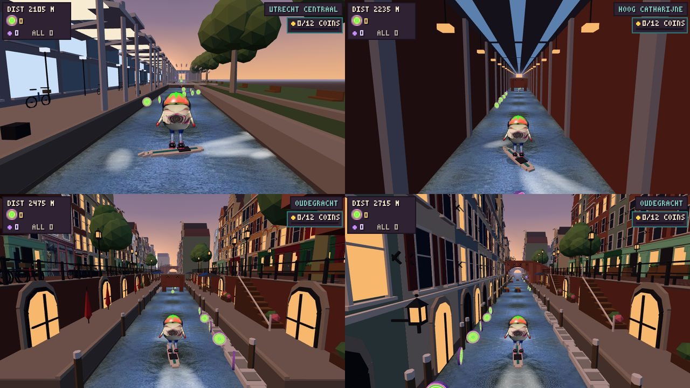

*In the game: the basin at Utrecht Centraal, the covered gallery of Hoog Catharijne and two views of the Oudegracht (real renders of the running game, on the surfboard).*

**Demonstration:** `docs/downloads/wayfarer-utrecht-demo.mp4` (43 s, 960 x 540, captions in French): a real run of the game from the Gare du Midi (the cutscene, the train) through the basin, the covered gallery and the Oudegracht to the junction, driven by a small bot (`node tools/demo_utrecht.js`). Stills: `docs/screenshots/utrecht-demo-sheet.jpg`.

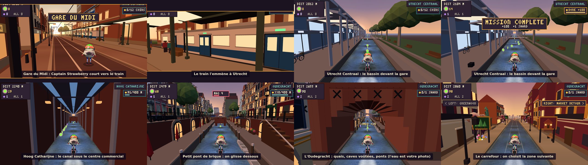

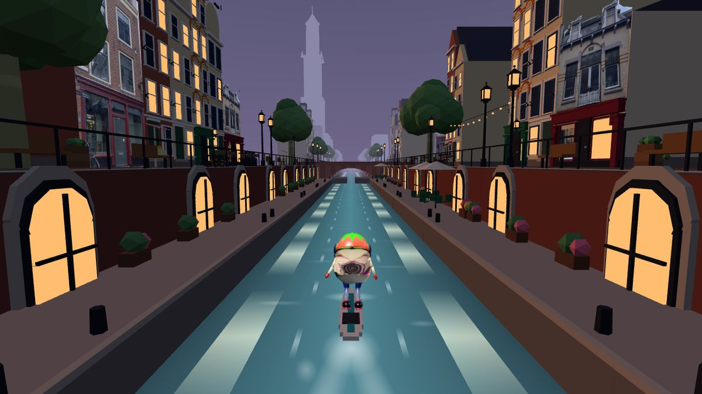

**The Gare du Midi (the end of Saint-Gilles, and a cutscene).** The street ends at the station: the track segment `gareMidi` (1300 units, biome `gare`, same sunset atmosphere as the street, `src3d/env_gare.js`): to the right of the road a platform with a canopy and lamps, the tracks, a brick station flank with tall glowing arched windows, and, as fixed props of the segment, the station hall with a clock tower and the BRUXELLES-MIDI board (with BRUSSEL-ZUID) and, far away, the Tour du Midi (an original low-poly take on the place, not a copy). The street's slope eases out before it. The road is clear: no hazards in this stretch and the coins stop before the scene. When Captain Strawberry reaches the middle of the segment the game takes the controls away (`Game.beginScene`, state `scene`): the runner **keeps running by itself** to a 28 m train waiting at the platform (`src3d/train3d.js`: three coaches, sliding doors, lit windows, a yellow cab), drifts over to the open door, **steps in** (`ALL ABOARD`), the doors close with a horn, the train pulls out (`NEXT ZONE`) and the screen fades to black. Then the run resumes 100 units further on with a fade-in, and 300 units later the train has taken it to Utrecht (below). While the scene plays, no key, tap or click does anything, nothing hits the runner and pause is off; the score, the coins and the distance carry on. The camera goes to a side view of the platform (letterbox bars, caption plates, `src/render.js drawSceneOverlay`). **A few people share the platform** (`src3d/crowd3d.js`: eight low-poly travellers, a pair chatting, a woman with a suitcase, a man with a backpack, two people walking along the platform with swinging legs, and a child who waves the train off; nobody within 6 m of the door). **No music in the scene:** it fades out in about a second when the scene starts and comes back slowly over a few seconds once the run resumes, and the scene has its own cinematic sound, all synthesised (no files; `GameAudio.voices`, with a shared reverb hall): the station chime, a bed of the place (the empty hall, the train idling, five people talking, a tinny loudspeaker announcement with its chimes), footsteps to the runner's stride that slow down as it stops, a suitcase rolling by, the pneumatic doors and their two-note chime, the guard's whistle, three door beeps, the doors closing, the train's horn and the train pulling out (rumble, sub swell, wheels over the rail joints getting quicker) as the screen fades. The voices are generated, so how convincing the "people" sound is a matter of taste: they are murmur and chatter, not recorded speech. The cutscene exists only in the 3D build (`Renderer3D.supportsScene`); `2d.html` has no scene and is unchanged (it skips the hall and tower props, which only the 3D build draws).

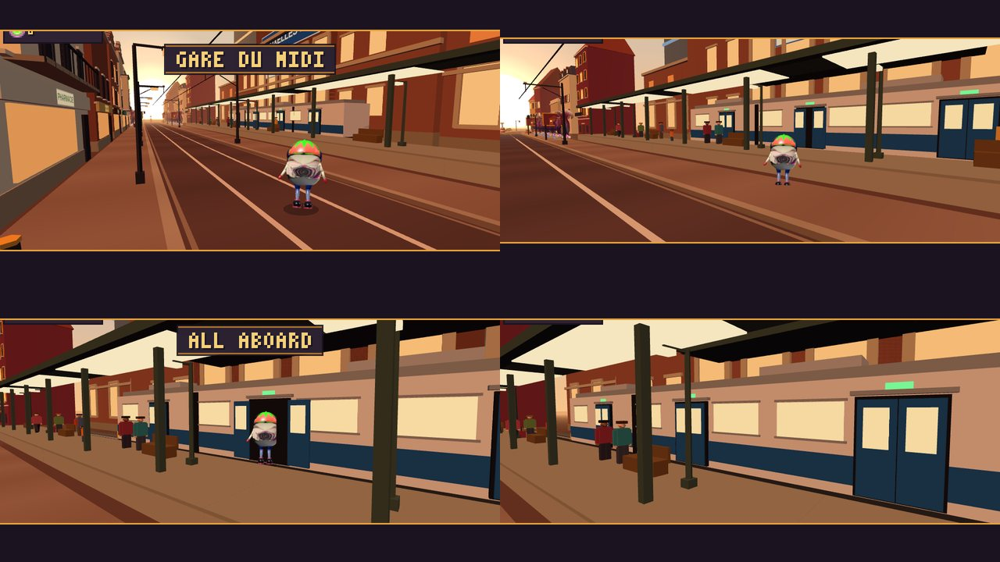


**The electromagnetic skateboard** is the second vehicle, next to the scooter (`RunnerSprite.buildBoard`, `src3d/board_art.js`, `src3d/board_assets.js`). Single boards (floating over a glowing pad) and board stations (a platform with four boards in a row) stand on the pavement of Saint-Gilles with the same disc as the scooters: the nearest one ahead is the one the disc offers, so the player chooses by which they reach (tap or click the disc, or **E**; **E** or HOP OFF to get off; `Game.vehicle` says which). A ridden board is a dark deck floating on a red glow, with glowing edges and magnetic pads, hovering with a gentle bob (the engine ring swells on the beat of the music), leaning with the steering and lifting its nose in the jump; **your picture of its rear** (the black oval with the red core, cut to its outline: `BOARD_ART`, 144 x 281 WebP) is the engine ring at the back, the part the chase camera sees, and it is also on the parked boards. Like the scooter it is drawing only (the rules are unchanged).

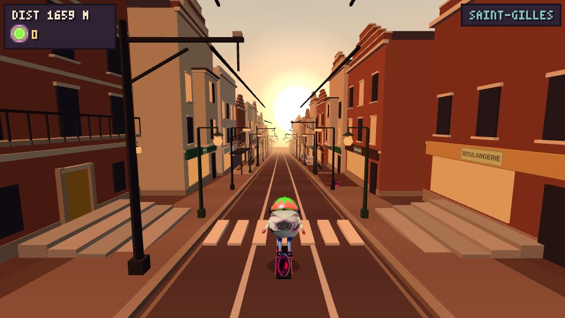

**The beds round the trees are mixed** (`src3d/flower_assets.js`, `src3d/tree_sprite.js`): your own flower disc is still there, but drawn at **0.62 of its old size** and with fewer upright flowers (`TreeSprite.BED_K`), and mixed with flowers cut from your two photos of Brussels flowers: a ring of small ground patches (red geraniums, yellow marigolds, white and pink lobelia, a red and green mix) lying round it, and upright cornflower heads (pink, blue, lilac, white) standing in it, on a second textured panel set with its own material (`FlowerArt`, one 512 x 256 WebP, 8 cells, only cropped, scaled and feathered round). All six kinds of tree get it, each with a few more patches and heads the bigger it is. The tree atlas itself is untouched.

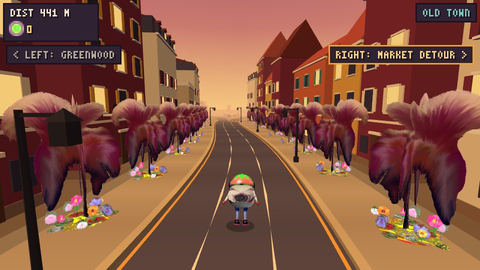

**Neon Quarter, fourth set of your pictures** (`src3d/neon_assets4.js`, made by `tools/make_neon_assets4.py`: one WebP atlas of 1024 x 1844 cut from six of your pictures; the pictures are only cropped and scaled, never recoloured or redrawn; the lamp and the vault are cut out along their outlines). As you asked, **the outlined ones are DOORS**: the two teal tile rooms, the blue backlit panel and the teal tile wall are the doors of the shops and buildings of the quarter (22 of them: every tower, block, shop and picture block gets one, as an extra textured panel next to the prop's own; `ENV3D.neon.doors`) and **the rest are LAMPS**: five street lamps along the kerb, each a picture lit on a post (the filigree lamp, the hanging glass drops, the pierced screen as a lantern, the pink panel as a pillar, the lit restaurant front as a light box; the golden chandelier lamp was removed at your request), in a new stretch of lamps and scattered through the others. Two new stretch characters in all (lamps, and doors), ten now.

**The hotel** (`neonHotel`, a landmark): one of the quarter's towers, a blue glass door at its foot, over the entrance **the vault**, now in 3D: your burlap and plaster **LOUNGE** picture (the last one you sent, already cut out) is the front of a **low balcony that comes 2.6 m out of the hotel wall** (a plaster slab with a lit underside, side walls, a parapet behind the picture, a coping and two pillars; the picture stands on its front edge), and over it a neon HOTEL sign (drawn in code).

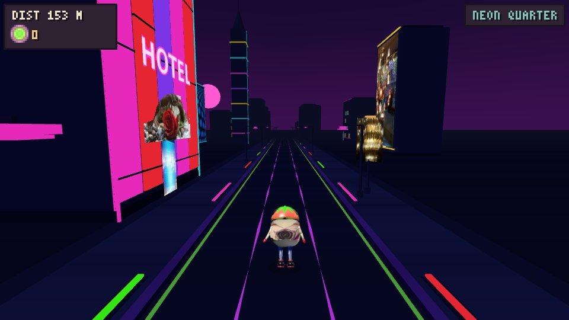

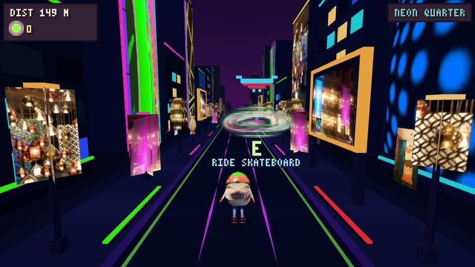

**Neon shop windows** (`src3d/neon_shops.js`, `src3d/env_neon.js`): the low shops of the Neon Quarter used to have one big coloured glowing slab for a front. They now have real glass windows: three panes in a neon frame with mullions, a lit door, the stripe and the awning above, and **every pane shows a different display** (16 in all: a dress on a mannequin, sneakers on a pedestal, a shelf of bottles, a plant, cupcakes, a retro TV, vinyl records, sunglasses, cocktails, a ramen bowl, a fish tank, a floor lamp, books, balloons, a vintage camera, hats), each drawn at start-up on one small canvas atlas (no image file, none of your pictures). Six shop designs (`neonShopA/B/F/G/H/I`) with different colours, widths and displays, so no two panes of a shop are alike, no two shops are alike, and the street never puts the same shop twice in a row on a side. The shops made from your pictures (`neonShopC`, `neonShopD`) are untouched.

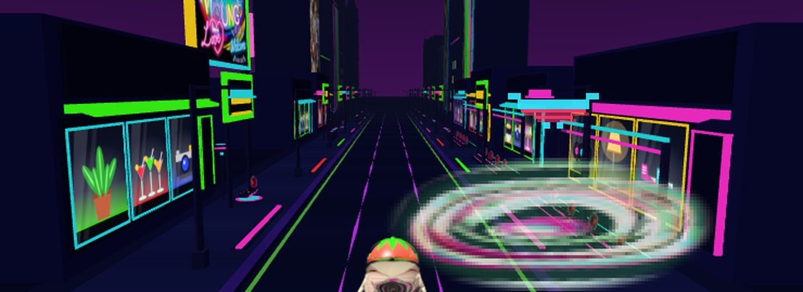

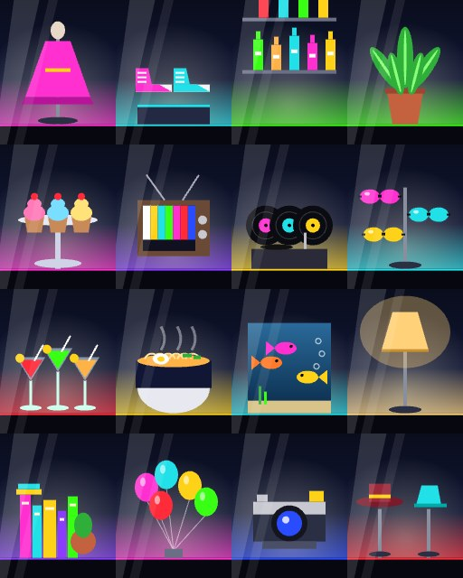

**In the Neon Quarter** the electromagnetic skateboard is there too, in neon colours: single boards floating over a magenta and cyan pad with a hologram pylon (two floating rings) and stations (a platform with edge lights, four boards in a row, an arch of light tubes), placed on about one side in seven and one in fourteen of the slots (`neonHover`, `neonHoverDock` in `src3d/env_neon.js`), with the same disc. The board itself was made more sophisticated for both zones (`RunnerSprite.boardParts`: a carbon deck with kicked nose and tail, light bars along the edges, a guide line and chevrons, two lit side fins, a front sensor, three levitation coils under the deck, an underglow slab, a rear engine block with two nozzles) and a ridden board floats on a **magnetic field**: a soft glowing disc on the road, a cyan ring that breathes and swells on the beat, a fading light trail behind. The vehicles belong to Saint-Gilles and the Neon Quarter: leaving them puts the runner back on foot. 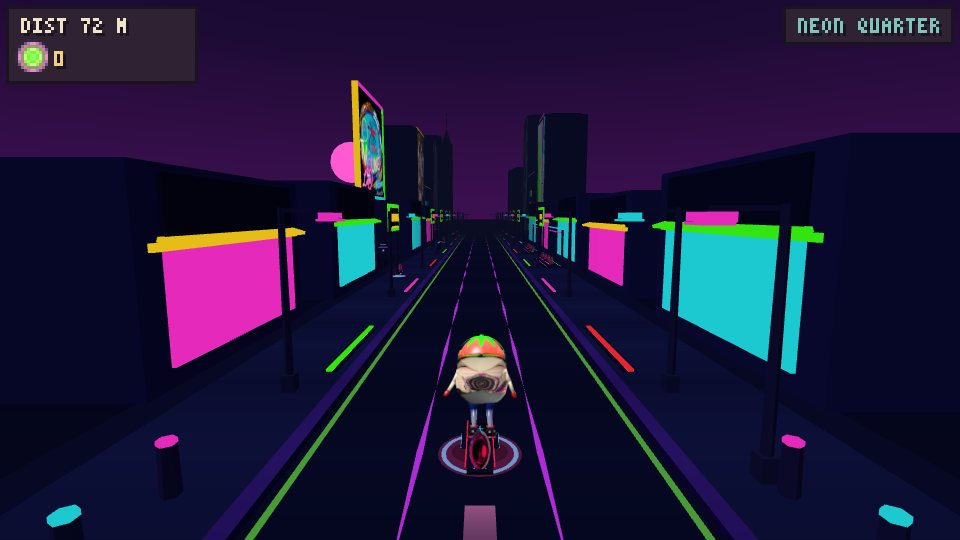

None of your uploaded pictures was changed: the board's rear, the swirl disc, the trees, the avatar and the rest are used as they were.

The trees are **your blossom-tree photo** (`src3d/blossom_assets.js` / `blossom_sprite.js`): cut out along the outline you drew (the crown closed up into a dense mass, the trunk kept), embedded as one WebP with alpha, drawn like the feather trees as two crossed planes 7.5 m tall and toned warm (`BlossomSprite.TINT`). From your three later photos the street was enriched: four more houses (an ochre-brick Art Nouveau house with red brick bands, a stone door surround, a wooden door and a big iron balcony; a white house with a dark-blue oriel; a red-brick corner house with a glowing green pharmacy cross and a wall lantern; a modern white block over dark brick), the dark-green lantern street lamps, rows of black bollards, street signs (parking, no entry), hedges, white market canopies over crates, stone steps, a parked lime e-scooter, manhole covers, a painted pedestrian crossing, and two more landmarks: the **school** (red brick with stone bands and a painted mural in each arched window) and a tall **glass tower** in the distance, gold where it catches the sun. The stretches now have seven characters (the two new ones: an Art Nouveau terrace, and a market corner). Shop fronts carry lettered fascias, and three landmarks appear at most once per stretch: the **Polyclinique** block (its vertical POLYCLINIQUE blade sign and the VERHAEGEN fascia from your photos), a **tram stop** with a TRAM plate, and a corner cafe. The signs are drawn at start-up on one small canvas atlas (`TramArt`, 14 cells, no image file). The street runs **downhill** (the last two photos were taken on a descent): the segment has `grade: 0.07` (7 %), and the road, the scenery, the coins and the hazards sit lower the further ahead they are, so the sun hangs above the road's far end. It is drawing only: gameplay stays flat (the runner is always at height 0), and `World.dropAt` / `gradeAt` give the fall, in proportion to the district blend so the slope eases in and out with the atmosphere; the far ground tips down with it so the road never sinks under it. Both photos are used for the look (palette, composition, signs), not pasted in: the street is built from low-poly parts like the other zones.


**Menu:** both panels are your own artwork (`src3d/ui_assets.js`, drawn by `Renderer.drawTitle3D` / `artPanel`). The title panel (top) keeps its text over the dark part, with the glowing red line between 'PROTOTYPE 01' and 'TAKE A FORK.'; the controls panel (below, whose text changes on a phone) is drawn under a dark veil so the text stays readable. The main button (it says PLAY in the 3D menu; the 2D page keeps START) is your ring artwork too (a band through the middle of your image; it glows green on hover and darkens when pressed, on a dark base with a dark plate behind the green label, so there is no white). If an image is missing, the usual drawn panel or amber button is used. RESUME and RUN AGAIN stay plain amber.

**World variety (all deterministic, no random state):**
- *Obstacle patterns* (`World.genSegment`): each spot takes a seeded pick from its segment's pattern list, never the same pattern twice running, and the gap to the next spot is the base spacing plus 0-49 seeded units (never less, so hazards stay >= 19 m apart). The run still opens with the gentle first pattern.
- *Segments:* `cityRunB`, `plazaB`, `forestB`, `detourB` and a second junction `gate2` (same biomes and names, different curves and lengths) join the loop.
- *Scenery stretches* (`src3d/stretch.js`): slots are grouped into stretches of 4-13 slots (50-150 m), each with its own character, and at most one landmark. Neighbouring stretches always differ (the variant and landmark kind are drawn from list entries of alternating parity) and landmarks are >= 3 slots apart. City: terrace, tree avenue, open square, shops, tall houses with gaps, walled walk; landmarks fountain / clock tower / statue. Forest: dense wood, clearing, pine stand, grove, rocky, fenced pasture; landmarks cabin / giant oak / standing stones. Market: stalls, open market, arcade, cobbles; landmarks market hall / fountain / big tent. Extra street furniture: walls, cafe tables, bollards, barrels, stumps, flowers, boulders.
- *Grass:* the forest's grass (verge, borders, curbs) is a dusk violet instead of green, with a violet sky, a dusty-rose fog and a violet ground light, to match the pink trees and the sunset. The bushes stay green.
- *Trees:* every tree (city, forest, giant oak) is your feather-tree artwork (`src3d/tree_sprite.js`, image in `src3d/tree_assets.js`): two crossed double-sided planes with one shared texture and material, a different height per kind (4.6 m to 12 m). Each tree stands in the middle of a round bed of flowers lying on the ground (a disc cut from the flower circle of your other image, tinted warm yellow / orange and brightened, radius 0.23 x height + 0.4 m, 1.5 m for the city tree up to 3.2 m for the giant oak) with a ring of upright flowers (pink, yellow, orange; two crossed planes each, 0.4-0.75 m tall, 10 to 23 per bed, placed by a fixed formula) round its rim. Tree, bed and flowers share one atlas texture, so there is still one draw per tree. They are unlit, so the artwork keeps its colours, but fogged like the rest.
- *Transitions:* the biome of each side switches once, cleanly, as the blend passes about half, and a small entrance marker (stone gate post / carved wood post / pennant pole) stands where the street changes character.
- Pools are fixed-size and shared (peak use <= 71 %); layouts are cached per slot and trimmed.


**How a junction works**
- The track is data (`src/track.js`): a `sequence` of segments (each with a biome, length, curve, obstacle patterns) and a `fork` (diverge zone, branch length, merge zone, biome blend, which segment each side leads to). `src/world.js` turns it into pieces and answers "where are the road(s) at distance z?" for gameplay and rendering alike.
- Road geometry (`src3d/road3d.js`): the road, curbs, sidewalks and verges are two *ribbon* meshes rewritten each frame from that data, so a fork is real geometry: one road splits into two that diverge, run apart, and merge back, with the same width, surface height and curve as gameplay. Where roads touch, each takes its half up to the midline (no overlap, no z-fighting); the inner curbs shrink to nothing at the tip. A prebuilt straight segment mesh cannot do this, which is why the road is streamed (64 sections x 3 m, always reused); scenery and items use bounded pools.
- Choosing: a LEFT / RIGHT prompt appears 76 m before the junction, with two route signposts and the visible fork. Steering is free until then and never picks a road by itself. A left/right input given inside the prompt window is the pick (highlighted in the prompt); with no input the side you are standing on is used. The pick is locked when you cross the junction line (once per junction); in the last 35 m before it the runner is eased onto the picked road, and afterwards the opposite key cannot re-route.
- Camera: a chase camera behind and above the runner that follows the active route's centre, looks 20 m down it, and blends gradually into the fork's biome. Sky, fog and light colours, road palette and scenery all blend between city, forest and market (scenery per road side is chosen per 12 m slot by the blend at that spot).
- Biomes are `src3d/env_city.js`, `env_forest.js`, `env_market.js` (colours, road palette, props, layout rule); the market detour reuses the city's buildings and street props with a different layout and a warmer cobbled road. A new biome is a new `ENV3D.<id>` plus a segment in `track.js`.

**Avatar:** your own retouched artwork (`src3d/runner_sprite.js`, images embedded in `src3d/avatar_assets.js`), shown as flat cards that always face the camera: the **back view** while playing (the chase camera sees the runner from behind) and, by default, the same back view in the main menu (`?menu=side` shows the side view instead), turned to face the menu camera as it orbits, with an idle / wave / spin / dance / run-in-place showcase. With no skeleton, the motion is applied to the whole card: run bounce and squash-and-stretch, a steering lean, a stretch in the jump, ducking (squashed to 42 % of its height, under 0.9 m) for the slide, tipping forward on a crash. It stands 1.9 m tall with its feet on the road. `?avatar=3d` in the URL selects the earlier 3D strawberry-man model (`src3d/runner3d.js`) instead; the transparent PNG exports in `docs/downloads` come from that model.

**Gameplay loop (shared rules in `src/game.js`, drawn in 3D)**
- *Controls:* steer left/right (arrows or A/D, continuous across the three marked lanes), Space/Up jump (0.55 s, ~3 m apex, 0.12 s landing buffer), Down slide (0.55 s; tapping again mid-slide does not chain it; Down in the air fast-falls; a jump cancels a slide). Forward movement is automatic. Auto-repeat key events are ignored; jump/slide always return to running.
- *Coins:* pooled ringed coins (green core, cream and lime bands, a pink ring and a lilac edge) that spin and bob, in lines, groups, zig-zags and left/right lane trails, plus a coin trail on each branch of a fork. Pickup box: ~0.7 m sideways, ~0.9 m in depth, and the runner's body height must overlap the coin height (high coins need a jump). The counter updates the frame you pass through; each coin counts once; a collected coin disappears in that same frame (it is flagged `taken` and skipped by the draw loop) and a separate burst of tiny green / pink / lilac sparks plays for 0.3 s. The sparks deliberately do not use the coin mesh: a coin-shaped effect at the same spot looks exactly like the coin staying on the track.
- *Hazards (what you see is what you hit — meshes are built from the collision table `OBST`):* crate (1.2 m, jump), low striped barrier (2.8 m wide, jump), overhead gate (banner 1.05 m above the road, slide; you can only get round it at the very edge of the road). Spacing is >= 19.5 m, the first hazard is ~69 m in, and the last 66 m before every junction is hazard-free (that stretch is where the picked road gently guides the runner).
- *Game over:* any collision ends the run: debris burst, screen shake, red flash, the avatar tips over. Distance, speed, coins, spawning and track updates all stop and the chosen route is kept; the panel shows distance, coins, score and best. Restart (button, Space, Enter, R) gives a clean run.
- *Difficulty:* speed starts at 22 m/s and rises 0.16 m/s per second to a 34 m/s cap; distance is the integral of speed and is unaffected by forks or recycling.

**Works in 3D:** all of the above, plus pause, touch controls, resizing, both branches with hazards and coins active.

**Tested** (headless Chromium, software WebGL, simulation stepped frame by frame; suites live outside the repo): 3D gameplay 35 checks, 3D routes/geometry 34, 3D phone touch 9, 2D regression 50; plus extra probes: frame-rate independence (clearing windows match from 20 to 144 fps, no tunnelling at 34 m/s), input state-machine fuzz (6 simulated minutes, 17 restarts), a brute-force survivability search over every distinct hazard pair of the looping track on both branches at 22 and 34 m/s (all 37 pairs clearable), and a 12-minute bot run through 62 junctions with constant memory.

**Limitations**
- Real-device frame rate and touch feel are not measured. Per-frame JavaScript allocation in the 3D draw path is about 12 KB (down from 57 KB), mostly small temporaries.
- Steering is continuous across the road (as in the 2D game), not snapping between three lanes. Collision uses the hit boxes above; the avatar's hair and outstretched arms are drawn slightly taller/wider than its 1.8 m hit box, so a close shave is forgiving, never a phantom hit.
- The road you did not take stays visible with its coins and hazards (it cannot be touched: you are confined to your road and the two are metres apart). Pickup sparkles and dust are 2D-only; the 3D build has its own coin pop and crash debris.

## Power-ups, shards, missions and skill (3D build)

The 3D game has a depth layer on top of the same rules (`src/perks.js` for the rules, `src3d/perks3d.js` and `src3d/items3d.js` for the look, `Renderer.drawPerksHud` for the HUD). The classic `2d.html` has none of it: `World.extras` and `Game.pk` are only switched on by a front end that sets `supportsPerks`, and the classic world generator is byte-for-byte what it was.

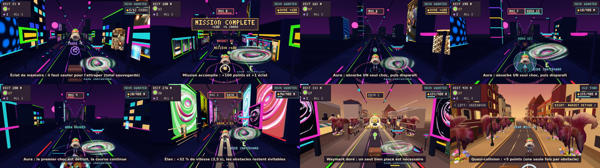

*A shard, a mission completed, the magnet at work, the aura, its break, the dash, a waymark and a near miss, from a staged run on the real road (the items are placed by hand, the game and its HUD are the real ones). The whole run, 19 s with captions in French: `docs/downloads/wayfarer-perks-demo.mp4`, made by `node tools/demo_perks.js`.*

**Three power-ups**, each with its own model, colour, sound and effect, none stacking with itself and none able to make the run unfair:
- **Magnet** (red horseshoe, 8 s): coins up to 150 units ahead and about one lane to either side glide into the runner; two soft rings swell from its feet while it works.
- **Protective Aura** (teal shield bubble, 15 s): takes exactly ONE hit, which destroys that hazard (a pop and a ring), then it is gone; it also times out. A second aura picked up while one is on only restarts its clock.
- **Wayfinder Dash** (two orange chevrons in a ring, 3.5 s): +32 % forward speed (eased in and out; the run's own speed ramp is untouched), orange streaks, speed lines and a slightly wider view. A dash that is not cut short by a hit pays 10 points per hazard passed and 25 at the end. Every pattern is still avoidable at dash speed (see tests).
Power-ups are at least 240 m apart on a road, never in the first 70 m and never near a hazard in their lane (the dash also needs 130 units clear ahead); each road, including both branches of a fork, gets its own. Effects are chips at the top centre (bar + seconds, blinking in the last two seconds). They only advance in `Game.step`, so a pause, a cutscene or a game over freezes or ends them; `reset()` starts every run from nothing.

**Two rarer collectibles.** *Memory Shards* (violet crystals with two chips orbiting them) lie at the edge of the road, high up (a jump) or as a pair on both edges (one side only); they feed a separate **saved total**. *Golden Waymarks* (a gold diamond in two crossed rings) are the route-specific ones: one per fork road, each at a spot that needs a deliberate move: a high jump over a crate (market), a jump over a fallen wall (ruins), a slide under a gate (forest and neon), or the one free lane (coast). Each pickup registers once (`taken`), is drawn from a pool and pays +50 points for a waymark.

**Missions** rotate: collect coins (12, then 18, 24 ... up to 60), travel a distance (400 m, 550 ... up to 2000), then a special one (a shard, a few near misses, a power-up). Progress is per run (top right: `5/12 COINS` with a bar); finishing one pays +100 points and +1 shard, flashes the plate and plays a short fanfare, and the next one starts 3 s later. A mission that was not finished is offered again next run; the counter of the missions done is what is saved.

**Skill.** A *near miss* (a genuine close pass: under 0.35 m beside a hazard having been headed for it, or a jump that clears one by under 0.38 m) pays +5 once per hazard, checked when the hazard passes the runner, so it is the same at any frame rate and speed; passing a whole sequence of hazards cleanly (the crate-then-barrier, staggered crates and similar combos) pays +20 once, nothing if the aura took a hit in it.

**New obstacle patterns** (`PATTERNS_X` in `src/track.js`, same crate / barrier / gate boxes, introduced by distance): a crate then a barrier 40 units later (one jump clears both, from a take-off range at least 55 units wide at every speed), a gate followed by a coin trail at sliding height that drifts to the right lane, crates staggered across the three lanes 100 units apart, a gate then a barrier (slide, then jump once the gate is behind), and a barrier then two outer crates with the middle lane free. Each one is followed by the usual gap after its LAST hazard (at least 195 units), none touches the stretch before a junction, and `tests/qa3d_perks.js` plays every one from each lane at 340 units/s and in a dash.

**Saved progress** (only this, `localStorage` key `wayfarer.progress`): `{ shards, waymarks per route, missions { done, idx } }`. Anything missing or invalid is replaced field by field by a safe value (clamped integers, route keys checked, at most 24); a storage that throws changes nothing. Effects, run counts and mission progress are never saved. The game-over panel shows this run and the saved totals.

## Controls (keyboard)

| Key | Action |
|---|---|
| Q / D, A / D or ← / → | steer (Q, Z, S, D work by letter on any layout; on an AZERTY keyboard the ZQSD keys work by position too) |
| Space, Z, W or ↑ | jump (crates, low barriers) |
| S or ↓ | slide (overhead banners and vines) |
| P or Esc | pause / resume |
| Enter, Space or R | start / restart (the on-screen buttons work too) |

**Touch buttons** (phones): each one wears your neon ring picture (`src/touch_assets.js`, scaled to the overlay's pixel grid, with its arrow or pause symbol drawn over it; a held button grows and lights up). The hit boxes did not change.


At a fork, lean to the road you want (or tap ← / →) before crossing the junction line. The prompt shows the current pick.

## Layout

```
index.html (3D game), 2d.html (classic 2D), 3d.html (redirect to index.html), style.css
src/audio.js    sound: the music track + beat clock, synthesised effects, mute
assets/         music.mp3 (the track)
src3d/*         3D front end: kit, road3d, stretch (scenery stretches), env_city/forest/market/neon/tram/coast/ruins (+ neon_art / neon_assets, tram_art, blossom_sprite + blossom_assets, board_art + board_assets, neon_shops, flower_assets), runner_sprite + avatar_assets (the artwork avatar), tree_sprite + tree_assets (the artwork trees), ui_assets (the menu-panel artwork), runner3d (the 3D model), items3d, fx3d, signs3d, renderer3d, main3d
vendor/         three.min.js (Three.js r186)
tools/preview3d.html  dev page that renders one 3D module in isolation
tests/qa3d_coins.js   regression test: coin pickup (coins vanish at once, count once, can't be re-collected, pool reuse, both branches, restart)
tests/qa3d_world.js   regression test: world variety, track integrity, pools, six junctions played
tests/qa3d_audio.js   regression test: sound and music (locked until a gesture, the track and its beat grid checked against the decoded mp3, every event's effect, offline-rendered effects, mute, animation on the beat)
tests/qa3d_dest.js     regression test: the destinations (the junction detours of the circuit and the coast / neon / ruins branch definitions: routes, order by seed, forks, signs, identity patterns at top speed, a whole run through the coast, ruins and neon branches with road and camera checked, pools over repeated route cycles)
tests/qa3d_coastzone.js regression test: the independent coastal zone (the track and the rotation of its four lights at each passage, also by seed, the four atmospheres and the coast music, a bot through each piece, the Strawberry Beach Club and Club Delphi, 2D)
tests/qa3d_utrecht.js  regression test: the Utrecht zone (the track and its hand-over after the cutscene, the surfboard, the water strip, the water looks of the hazards, camera clearance, the props, a bot through the whole zone, 2D untouched)
tests/qa3d_perks.js    regression test: power-ups (magnet, aura, dash), shards, waymarks, missions, near misses, the skill patterns (all avoidable at top speed and in a dash), saved progress (also corrupt), pause / restart, HUD, pools, sounds, 2D untouched
tests/qa3d_gare.js     regression test: the Gare du Midi (sequence, props, atmosphere hand-over, the cutscene timeline with no player control, hazards ignored, score kept, resume, camera / train / overlay, no music in the scene and the sounds cut to the picture, the platform crowd, pools, 2D untouched)
tests/qa3d_town.js     regression test: the coastal town and the sunburst parasols (the order and the lights of the beach zone, the seamless hand-over, the long buildings apart from the chalets, the picture as sent, towers, roundabouts, the landing pad, the saucer that takes off, pools, 2D untouched)
tests/qa3d_portal.js   regression test: the Stargate passages (which changes of zone have doors, none out of the Gare du Midi, the picture as sent, the black hole, the doors on the road and their fade, the journey of the runner, the hazard-free road, the light and the voices, the overlay, reduced motion, 2D untouched)
tests/qa3d_scooter.js  regression test: the optional scooter of Saint-Gilles (indicator, E / click / HOP OFF, ends with the zone, glide, wheels, lean, size, gameplay untouched, ?scooter=1/0)
tests/qa3d_controls.js regression test: keyboard bindings (arrows, WASD, ZQSD / AZERTY), the neon-ring touch buttons and the menu key text
tests/qa3d_ui.js      regression test: both menu-panel artworks load, are drawn, controls text legible (with a fallback to the drawn panels)
tests/qa3d_avatar.js  regression test: the artwork avatar (default), ?avatar=3d, images load (also from file://), view per state, size / ground / slide height, faces the camera, no leaks
src/biomes.js   palette + biome definitions (city, forest, market)
src/track.js    track pieces, obstacle patterns, collision boxes
src/world.js    road geometry, fork/merge logic, item spawning
src/sprites.js  programmatic pixel-art sprites and skylines
src/font.js     3×5 pixel font
src/render.js   drawing: sky, road, objects, HUD, screens
src/game.js     state, input, loop, collisions, scoring
```

## Sound and music

- **Music:** your "Deep Disco" track (`assets/music.mp3`, 172 s, looped; converted from the m4a and lowered 3 dB so it does not clip) plays from the first tap or key press (browsers do not allow sound before one; on phones a touch's first event is not accepted as a gesture, so every gesture retries until the music is really playing). Its volume follows the game: softer in the menu, full while running, ducked on pause and after a crash. **A second track belongs to the Sunset Coast**: your "afro Mediterraneo", **cut to its closing 7 bars as you chose with the cutting page** (`assets/music_coast.mp3`: 2:37.09 to 2:51.01 of the full track, 13.92 s = exactly 28 beats, looped; the 4 ms fade-in starts 3 ms before the bar line so the first kick keeps its attack, and the last beat is the track's own silence; 224 kB instead of 2.7 MB; its own beat map `src3d/music_beats_coast.js`, 120.7 BPM, made with `tools/make_beatmap.py` given the beat period of the full track because the tempo search is unreliable on 14 s). At -17.0 LUFS the clip sits at the level of Deep Disco (-16.9), so the crossfade has no jump. The full track is in the git history (commit before this one) if another cut is wanted. It crossfades with Deep Disco as the road enters and leaves the coast branch (a few seconds each way, following the game's biome blend; the two together are never louder than the music volume), starts from its beginning on every visit, is never played in the menu, follows the M mute, and drives the beat animation (the avatar, the lights) while it is the louder one. It is silent at first; on the first tap it is started at volume 0 and stopped at once so that browsers like iOS Safari will let the game play it later (so it is fetched at the first tap).
- **Animation to the beat:** the track is a steady 117.7 BPM and `src3d/music_beats.js` holds its beat grid and loudness curves, computed offline (`tools/make_beatmap.py`), so nothing is analysed in the browser (that would not work from `file://`). On every kick the avatar bounces and stretches, the scene light and all the glowing neon parts brighten, and the PLAY button glows green; the effect is stronger in the neon quarter and weaker in quiet parts of the track. Before the sound starts the same clock runs at the same tempo, so the menu already moves in time.
- **Effects** (synthesised with the Web Audio API, no sound files): jump, land, slide, coin (the pitch climbs with a streak of coins), crash, game-over jingle, fork prompt and fork choice, start, pause and resume, and, for the Gare du Midi scene (where the music is turned off), the station soundscape described above.
- **Mute:** `M`, or the speaker icon at the bottom right of the menu / pause / game-over screens; remembered between visits.
- The classic 2D page (`2d.html`) is silent.
- To change the music: put another track in `assets/music.mp3` and run the two ffmpeg / python commands at the top of `tools/make_beatmap.py`.

## Dabke video

`docs/downloads/dabke-neon-quarter.mp4` (33 s, 960x540, 30 fps, with sound): five copies of the character (the 3D model, which has legs and arms) dance dabke in the Neon Quarter. Dabke is the stomping line dance of Syria and the Levant, so they hold hands in a line, step sideways together, stamp on the beat (a neon ring spreads from every stamp), and the leader on the right swings a red-and-white handkerchief and twirls once. Five camera shots cut on the beat. The sound is your track from 2:16 plus a synthesised dabke percussion layer (the maqsum rhythm, foot stamps on the steps, claps) on the track's beat grid. It is rendered from the game's own scene, frame by frame and deterministically; `tools/dabke_video/` has the scripts (`render.js`, `make_drums.py`, `build.sh`) and reproduces the file byte for byte.

## Tests

```
npm i playwright-core            # once, anywhere (or point PW_CORE at an existing install)
CHROMIUM=/path/to/chrome node tests/qa3d_coins.js
CHROMIUM=/path/to/chrome node tests/qa3d_world.js
CHROMIUM=/path/to/chrome node tests/qa3d_avatar.js
CHROMIUM=/path/to/chrome node tests/qa3d_ui.js
CHROMIUM=/path/to/chrome node tests/qa3d_audio.js
```

Set `TEST_URL=https://your-deployment/` to run the same checks against a deployed copy. Both start their own static server, drive the real page (scene graph and game rules, WebGL stubbed for speed) and exit non-zero on failure. `qa3d_coins.js` asserts on every frame that the number of coin meshes on screen equals the number of uncollected coins in range, so a collected coin that stays visible (or an effect built from the coin mesh) fails at once.

Score = distance in metres + 10 per coin. Best score is kept in `localStorage`.
